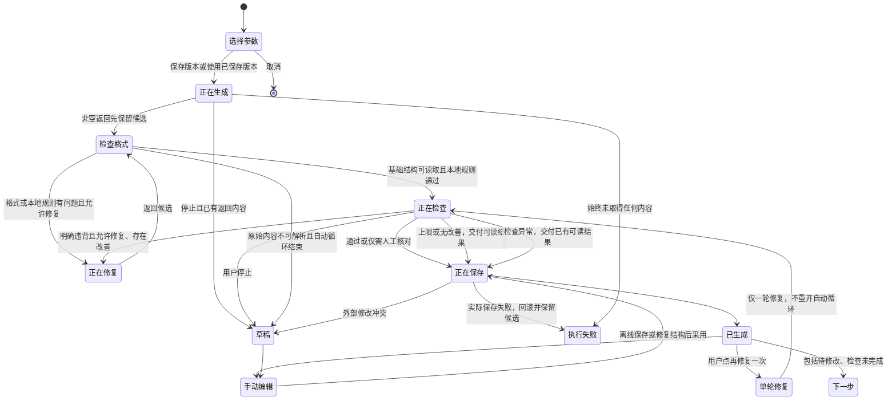

# 世界设定循环与端到端验收

适用范围：势力、人物及关系、世界观及名称规则、逐份人物背景、分步与完整世界设定。标题推荐保持一次生成，不增加语义评审循环。结构、场景、章节的循环本轮未重构。

## 运行规则与状态图

每份产物初次生成一次，最多自动修复两次。不设置总请求次数和整轮时限，也不设置 120 秒整次请求期限；网络连接和读写沿用 SDK 超时，SDK 自动重试关闭。暂时性网络故障单次操作最多尝试三次，耗尽后原样抛出。人工设定前置检查与生成不再共享预算。请求数和耗时只作记录。

连续两次检查仍违背相同参数时提前结束；检查文字的措辞变化不算改善。仍有具体问题得到解决时可以继续，达到质量修复上限后交付最后可读候选。结构校验的重复错误同样提前结束，不按剩余额度或耗时中断修复。



「已生成」细分为已生成、已生成待修改、已生成检查未完成。规则未通过不会变成任务失败。无法解析的 JSON 留在草稿，不替换有效结构文件；世界观登记表损坏时保留旧表、交付正文并提示。完整世界设定遇到待采用的原始草稿会暂停自动依赖步骤；用户可继续分步生成，使用的是当前已保存设定，需要使用草稿时先修复采用。

## 可复现的离线验收

```powershell
.\venv\Scripts\python.exe -m pytest tests/test_headless_stage_pipeline.py tests/test_lore_repository.py -q
.\venv\Scripts\python.exe -m pytest tests -q
```

当前自动化测试已精简，仅保留生成入口、设定仓储等核心回归；原界面端到端及 HTTP 故障专项测试已删除。下表和后续真实模型记录属于此前完整验收，不代表当前测试集的覆盖范围；对应 sandbox_*、quality_runs 产物也已按用户要求清理。

此前端到端测试使用实际 `MainWindow`、Qt 点击/事件循环、`TaskRunner`、任务工厂、生产阶段入口、生产检查修复与事务存储，只替换 SDK 客户端与配置；故障场景注入文件写入故障、事件门闩或时钟。

| 功能 / 场景 | 验收证据 |
|---|---|
| 人物正常生成 | 界面点击，2 次模型请求，正式 JSON 和生成记录落盘 |
| 参数版本三选一 | 真实任务分别收到界面新值、磁盘旧值或完全不发请求；草稿保留 |
| 数量及禁用元素 | 生成人数、势力数与本地校验一致；实际提示词含外交官及明确禁令 |
| 反复违背且无改善 | 2 次生成、2 次检查后交付当前人物，按钮恢复、问题带原文 |
| 仍有改善但达到上限 | 3 次生成、3 次检查后交付当前人物，实际请求不超过 6 |
| 用户主动再修复 | 只生成一轮并检查；不自动追加第二轮 |
| 检查异常 / 非法报告 | 可读候选正常保存，状态为检查未完成 |
| 空回复 / 网络超时 | 合计不超过 6 次；无内容才执行失败，不隐式重试 |
| 时间耗尽 | 可控时钟验证剩余请求期限；真实 SDK 传输验证整次墙钟期限 |
| 用户停止 / 重复点击 | 等待检查期间点停止，原候选保留草稿；重复启动被拒绝，无后续请求 |
| 原始内容不可解析 | 旧有效 JSON 不变；草稿编辑、结构修复、离线采用成功 |
| 外部修改 | 不覆盖外部版本；候选保留，可继续编辑 |
| 保存失败 | 人物单文件故障及世界观第二文件故障，均回滚旧正式内容并保留候选 |
| 重启与中断恢复 | 新窗口读取持久化记录；未完成记录恢复为草稿 |
| 编辑、改名与后续生成 | 编辑后重新打开保留；最新内容进入后续提示词；改名后的背景入口及单轮修复跟随新名称 |
| 势力、世界观、人物背景 | 各自走完整生产链；重复规则失败仍交付；世界观坏登记表不覆盖旧表 |
| 完整世界设定 | 顺序生成势力、人物、世界观、两份背景与标题；每份独立预算 |
| 标题兼容 | 一次生成、保存与刷新，无新增模型评审 |

当前保留 `test_lore_repository.py` 的保存、重启读取、引用及事务保护等核心验证；更细的编辑器、参数界面和参数全链路专项测试已经删除。上表仅作为历史生产链验收记录。

2026-10-22 全量离线回归：**1016 项测试、5 项子测试通过**，用时 136.79 秒。其中新增世界设定端到端文件包含 31 个场景；其余测试验证已有功能与模块边界兼容。最后的 API 范围收敛与草稿并发保护分别补跑 46 项、2 项，全部通过。

## 历史问题与修复清单

以下为旧版验收记录，其中请求预算与墙钟期限现已删除，不代表当前限制。

| 复现问题 | 修复与原场景复验 |
|---|---|
| 规则未通过抛错，用户没有当前结果可编辑 | 改为可读候选交付，记录待修改状态；重复失败 E2E 验证 |
| 网络、空回复、SDK 隐式重试叠加 | 统一底层请求预算，关闭 SDK 重试；空回复与网络故障 E2E 验证 |
| 单纯 read timeout 可能被慢速分段回复延长 | 增加整次异步请求墙钟期限，真实 SDK 传输测试验证取消 |
| 自动修复缺少上一轮完整候选 | 修复要求附上上一轮候选及具体问题，保留无关字段 |
| 重复问题只要换措辞就继续请求 | 按失败参数集合识别没有改善；另验证失败项减少时允许继续 |
| 人物发布丢弃额外顶层字段及元数据 | 发布保留完整候选字段；重启读取 E2E 验证 |
| 后一次空回复抹掉前次非空原始内容 | 保留最后非空返回及每次诊断原文；混合返回 E2E 验证 |
| 预算只剩一次仍开始修复，无法完成复查 | 修复前预留修复及检查额度，5 次请求时可正常交付最后已检查候选 |
| 文件和生成记录分两次写入有异常退出窗口 | 正式文件与交付记录放入同一事务，第二文件故障验证回滚 |
| 人工人物改名后，背景修复入口仍指向旧名 | 同一编辑事务同步背景记录的文件目标与人物信息，保留原始人物快照；改名后再次修复 E2E 验证 |
| 单份背景结果的重新生成扩大到所有背景 | 按当前人物限定重生成范围，E2E 验证只增加一份记录 |
| 两个窗口编辑同一份生成草稿会交叉覆盖 | 记录指纹与项目锁保护，后提交者保留编辑文本并提示冲突 |
| 已保存历史数量字符串导致重复询问参数版本 | 加载时规范整数控件值，未修改参数不再重复询问 |
| 页面仅按文件存在显示完成 | 增加持久化交付状态、退出原因、请求数、问题清单及结果操作入口 |

原场景都使用临时项目保留真实候选、检查报告和事务备份，文件位置见下节；自动化测试项目保留在 pytest 临时目录，真实项目未被重置。

## 真实模型验证记录

真实模型通过显式命令触发，可能产生费用；默认测试不会调用真实模型。命令拒绝覆盖已有验收目录：

```powershell
.\venv\Scripts\python.exe -m core.evaluation.lore_acceptance_probe --run-live --output sandbox_verify_lore_20261022/characters_v1
.\venv\Scripts\python.exe -m core.evaluation.lore_acceptance_probe --run-live --action full --output sandbox_verify_lore_20261022/full_v1
```

2026-10-22，使用当前本地配置的 hosted-llm 服务。记录、候选和报告保存在上述独立验收项目，不含密钥，也不覆盖 `current_work`。

- 人物单功能：2 次请求，83.72 秒，保存 2 位人物及关系，状态为已生成。人工阅读确认主角梁浩为生态博弈外交官；目标为协商城市供水，反派目标相反；未发现星际旅行、多种族、太空战斗。模型报告把全部参数判为通过，人工不将其视为绝对语义保证。
- 完整流程：360.75 秒，13 次实际请求，六份产物全部落盘，新窗口读取到 6 条交付记录。势力和人物各发生一次服务端 500，计入各自预算后重试成功，没有隐藏追加请求。

| 产物 | 实际请求 | 修复次数 | 产物耗时 | 交付 |
|---|---:|---:|---:|---|
| 势力集合（1 个） | 3 | 0 | 124.08 秒 | 已生成 |
| 人物集合（2 人及关系） | 3 | 0 | 88.55 秒 | 已生成 |
| 世界观与名称规则表 | 2 | 0 | 39.20 秒 | 已生成 |
| 林维背景 | 2 | 0 | 46.91 秒 | 已生成 |
| 沈佩背景 | 2 | 0 | 45.98 秒 | 已生成 |
| 推荐标题 | 1 | 0 | 4.67 秒 | 已生成，无语义检查 |

人工阅读结果：主角林维为水权调解官及谈判特使，沈佩的集权配给目标与其目标对立；人物与势力名称完整进入登记表；两份背景的出生年与现年（85+42、88+39）均对应静城纪年 127；未发现星际旅行、多种族或太空战斗。标题推荐未增加检查调用。

仍需作者判断的内容：个人谈判承担全城危机，是否符合作者心中的「个人规模」存在解释空间；登记表把人物和势力数量写成全局限制，可能过度限制后续创作。它们记录在验收项目的 `acceptance_summary.json`，可以通过现有编辑入口调整。模型自评均为通过，也不把这些创作判断当作已被模型证明。

最终代码离线重开两个真实验收项目，当前文件和状态均可读取；完整项目的 `acceptance_ui.png` 保存了应用实际样式下的结果页截图，已检查中文、计数和操作入口。真实模型验证不是所有题材、服务或长时间运行的穷尽验证。

另在 `sandbox_verify_lore_20261022/repair_v1` 验证真实单轮修复：从完整流程复制真实设定，离线将主角职业改成「刑警」，另加「母亲留下的铜纽扣」作为应保留的人工细节；通过界面修复入口发起一轮。115.33 秒、3 次实际请求（含一次 500 重试），修复次数为 1，没有追加自动修复。人工核对修复后职业为「水圈配额调解外交官」，铜纽扣、人物名称、年龄、关系及反派属性均保留，明确职业偏离得到改善。检查报告的子题材一项引用了元数据标签，证据偏弱，仍需创作者判断，未将这项自评作为充分证明。共计真实请求 18 次（人物 2、完整流程 13、主动修复 3）。

## 结果与诊断位置

- `system/lore_generation/results/`：交付记录、问题、退出原因和候选；界面「生成结果与草稿」读取。
- `system/generation_runs/`：生效参数、每次实际提示词、逐轮原始候选、检查原文与报告、网络错误。
- `system/lore_history/`：覆盖前备份、事务与回滚记录。
- `system/lore_edits.json`：当前设定版本、完整指纹、人工修改和下游待核对状态。
- 真实验收项目的 `acceptance_summary.json`：请求数、产物状态、耗时与新窗口读取结果。

手动保存不调用模型。自由文本旧名不自动全局替换，检查问题及旧称残留由用户核对；生成内容始终可能需要进一步修改。
