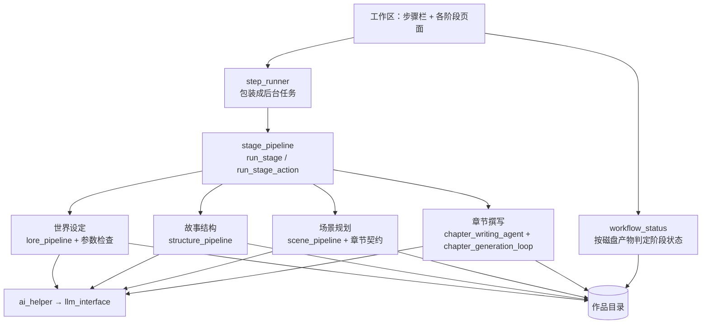
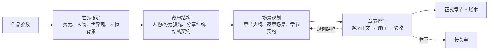

# 小说创作：架构设计

日期：2026-11-25。本文说明小说功能的结构和关键技术决定。
接口与文件见[接口设计](interfaces.md)，界面行为见[交互设计](interaction.md)，代码入口与验证见[开发文档](development.md)。
与短视频的边界见[两个功能的边界](../feature_boundaries.md)。

## 1. 系统结构

| 层 | 位置 | 职责 |
|---|---|---|
| 界面 | `core/gui/pages/novel/` | 步骤栏、作品参数和四个阶段页面；只读写参数与展示产物，不直接调模型 |
| 任务 | `core/gui/pages/novel/services/step_runner.py` | 把阶段调用包装成后台任务，共用一个任务通道 |
| 阶段入口 | `core/generation/stage_pipeline.py` | 与界面无关的统一入口；冻结参数、检查上游、分派到各阶段 |
| 各阶段生成 | `core/generation/*_pipeline.py` | 世界设定、故事结构、场景规划、短篇正文 |
| 章节循环 | `agents/writing/`、`core/generation/chapter_*.py` | 逐场写作、评审、定向重修、验收入账 |
| 评审 | `agents/review/`、`core/generation/domain_profiles.py` | 按题材选择评审维度和硬伤代码 |
| 存储 | `story_ledger.py`、`lore_repository.py`、`pending_review.py` | 账本、设定编辑事务、待复审记录 |

## 2. 数据流

- 篇幅选「短篇」时，故事结构产出一份情节大纲，场景规划不分章，正文当作第 1 章走同一套章节循环。
- 每个阶段从磁盘读上游产物。世界设定之后的阶段开始前，先检查人工改过的设定是否与作品参数冲突，冲突时停止并指出原文。

## 3. 关键决定

**参数快照。** 任务启动时冻结一份作品参数，运行期间改界面或改磁盘都不影响这次任务。每次阶段运行在 `system/generation_runs/` 记录生效参数和实际提示词，快照指纹相同即表示用的是同一份参数。

**状态以磁盘为准。** 步骤栏和工作流总览的状态都由 `workflow_status` 读磁盘产物和契约判定，用的是生成时同一套校验，所以界面显示与生成器的判断不会不一致。不依赖运行记录，手动改文件后刷新即可重新判定。

**世界设定：生成 → 检查 → 修复。** 每份产物先做本地字段与数量校验，再由模型逐条核对作品参数；明确违背时最多自动修复两次。规则没通过也交付可读候选（标「已生成，待修改」），不当作任务失败；原始内容不可读时留作草稿。

**章节：设计 → 生成 → 评审循环。** 一章的流程：

1. 规划评审：先审本章场景规划，问题退回重规划。
2. 逐场写作：每场写完做场景评审；只给下一场标题和后面场次的边界，防止提前写掉后面的事。
3. 章节闸门：契约合规、读者盲读、现实合理性三份模型评审，加一份不花调用的衔接检查。
4. 定向重修：按问题引用的原文把条目分到所在场次，只改有问题的场。
5. 验收入账：提取本章事实变化，与账本核对无矛盾后写入正式章节和账本。

被拦下的章节写成待复审记录，不进正式稿；问题的引文与场景规划大段相同时视为规划缺陷，退回规划修改后整章重写。批量写作遇到被拦下的章节会整轮停下，避免错误扩散到后文。

**题材档案。** 评审维度、硬伤代码和契约附加字段按题材分档（法律悬疑、推理、惊悚、恐怖、科幻、奇幻、爱情、历史、西部、通用），由题材（旧作品先看子题材）、主题与基调里的关键词依次匹配。

**质量闭环三档。** 「关闭」只写正文、不做题材评审；「标准」用档案自带门槛；「严格」提高平均分门槛并把重试次数拉满。世界设定的参数检查不受档位影响。
