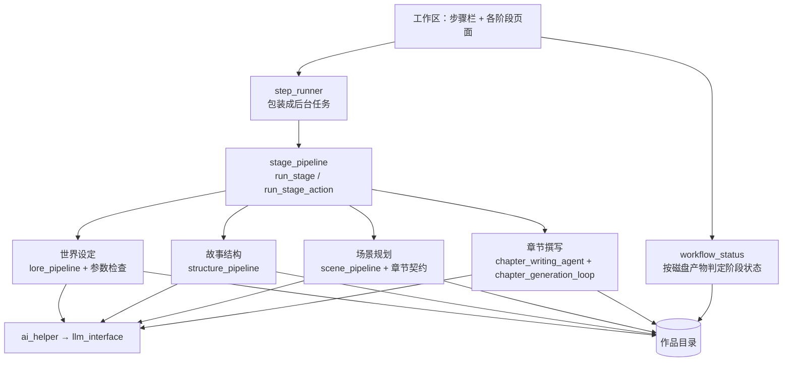
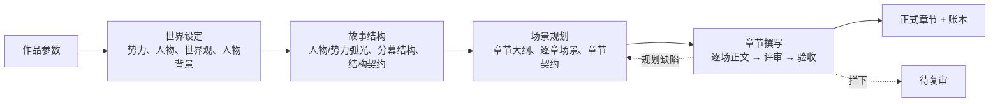

# 小说创作：架构设计

日期：2026-11-25。本文说明小说功能的结构和关键技术决定。
接口与文件见[接口设计](interfaces.md)，界面行为见[交互设计](interaction.md)，代码入口与验证见[开发文档](development.md)。
与短视频的边界见[两个功能的边界](../feature_boundaries.md)。

## 1. 系统结构

| 层 | 位置 | 职责 |
|---|---|---|
| 界面 | `core/gui/pages/novel/` | 步骤栏、作品参数和四个阶段页面；只读写参数与展示产物，不直接调模型 |
| 任务 | `core/gui/pages/novel/services/step_runner.py` | 把阶段调用包装成后台任务，共用一个任务通道 |
| 阶段入口 | `core/generation/stage_pipeline.py` | 与界面无关的统一入口；冻结参数、检查上游、分派到各阶段 |
| 各阶段生成 | `core/generation/*_pipeline.py` | 世界设定、故事结构、场景规划、短篇正文 |
| 章节循环 | `agents/writing/`、`core/generation/chapter_*.py` | 逐场写作、评审、定向重修、验收入账 |
| 评审 | `agents/review/`、`core/generation/domain_profiles.py` | 按题材选择评审维度和硬伤代码 |
| 存储 | `story_ledger.py`、`lore_repository.py`、`pending_review.py` | 账本、设定编辑事务、待复审记录 |

## 2. 数据流

- 篇幅选「短篇」时，故事结构产出一份情节大纲，场景规划不分章，正文当作第 1 章走同一套章节循环。
- 每个阶段从磁盘读上游产物。世界设定之后的阶段开始前，先检查人工改过的设定是否与作品参数冲突，冲突时停止并指出原文。

## 3. 关键决定

**参数快照。** 任务启动时冻结一份作品参数，运行期间改界面或改磁盘都不影响这次任务。每次阶段运行在 `system/generation_runs/` 记录生效参数和实际提示词，快照指纹相同即表示用的是同一份参数。

**材料由代码按结构挑，整块取舍。** 给模型的材料按用途列出要带哪几块，按重要性排，幕按结构里的先后，不按文件路径排；超出篇幅时从最不重要的一块起整块去掉并写明去掉了什么，不在一块中间按字数截。要不要重做按原始内容的指纹判断，跟材料的写法和取舍无关。写章节前整理全书设定、写每一场时的设定材料都这样做，取舍规则是同一套。写一场戏只带这一场用得上的：名称与规则登记表、本场人物的卡、相关势力、世界观正文、本场人物的背景；没出场的人物只在登记表里留一行。当前幕的故事结构和人物卡里的成长方向不带，它们写的是后面才发生的事，而写场景时一直在防模型提前写掉后面的事；本章没碰的悬念也不列，章节契约已经写明这一章推进哪几条。「规划场景」每章的材料也这样排：本章那一段大纲、名称与规则登记表、本章大纲点名人物的卡、相关势力、上一章结束时的状态、仍未了结的悬念和后续章节依赖、既有事实和时间事件（按编号和本章大纲点到的名字挑，写成「编号｜事实｜取值」）、前后相邻两章的大纲、世界观正文；不再每章都带整份世界设定和整幕大纲，人物背景也不带。英文字段名只留在要求模型输出的契约格式里，材料里的事实、时间事件和叙事图都是中文条目。「生成章节大纲」每一幕也带设定材料，排在这一幕的故事结构后面：名称与规则登记表、人物和势力名单（每人只写角色定位、职业和所属势力，每个势力写类型和活动地点；人物卡里的称号常和职业对不上，不带）、上一幕最后一章的大纲（参考，用来接上前情）；写法要求里说明人物、势力和地点用登记表里的名字，确实要加新人物时写明此人的身份。

**场景规划的提示词可以不花调用地检查。** 「生成章节大纲」「规划场景」发给模型的提示词由一组只读的函数拼出，正式流程和 `tools/check_planning.py` 用的是同一套：检查脚本能在任何作品副本上拼出每一章会收到的提示词，量场景边界、每块字数、截断和登记表外的名字，不调用模型，也不改作品目录里的文件。改规划流程时先跑它看基线，改完再跑一次对比。其中两项判断（每章场景数在不在建议范围里、有没有登记表里没有的人名和地名）正式流程也用：「生成章节大纲」「规划场景」收下一份大纲或规划之后，把结果写进运行记录，只记录、不打回，两边用的是 `planning_checks.py` 里同一套函数。

**提示词里不出现英文。** 不额外要求模型「只写中文」，只保证提示词本身是正常中文：小标题用「人物资料」「故事结构 · 开端」这类中文名，不用文件路径；正文不提英文文件名；人物的角色、性别和势力类型先换成中文再写进去。JSON 的字段名、编号和固定取值（`role`、`protagonist`、`open` 这类）仍是英文：程序靠它们读回结果，旧作品的文件也是这么存的。

**状态以磁盘为准。** 步骤栏和工作流总览的状态都由 `workflow_status` 读磁盘产物和契约判定，用的是生成时同一套校验，所以界面显示与生成器的判断不会不一致。不依赖运行记录，手动改文件后刷新即可重新判定。

**世界设定：生成 → 检查 → 修复。** 每份产物先做本地字段与数量校验，再由模型逐条核对作品参数；明确违背时最多自动修复两次。检查只说「信息不足、判断不了」时照样交付，意见记为检查备注，不算待处理：这类意见光看设定本来就判断不了，留给作者也只能放行。明确违背、修复后仍没解决的，交付可读结果并标「有问题，已保存」，不当作任务失败；原始内容不可读时不替换当前设定，只留原文。

**会覆盖人工修改的操作用撤回兜底，不弹确认。** 世界设定的每次改动（生成、修复、采用草稿、编辑、改名、全部标为已看过）都在 `system/lore_history/` 留前后两份完整快照，页面顶部可以连续撤回、恢复。以前靠「重新生成将覆盖人工修改」确认框挡，没手改过的覆盖连确认都没有，覆盖后也找不回来。撤回本身也算一次设定修改，照常给后面阶段记待核对。

**势力、人物数量按篇幅定。** 短篇 3 / 5、中篇 4 / 6、长篇 6 / 8，由系统套用，作者不填；参数文件格式不变，旧文件里的数量保留但不生效。

**世界设定的页面状态从生成记录推算。** 要不要处理、是否过期、还差什么、是否已就绪，都由已有的生成记录和磁盘文件算出来，不新增状态文件：每份产物看最新一次结果；保存时记下的文件指纹和磁盘不同就是手动改过；前面某项比后面的新，后面的就按旧内容写的。推算不出来（旧作品没有记录）时只显示数量。

**章节：设计 → 生成 → 评审循环。** 一章的流程：

1. 规划评审：先审本章场景规划，问题退回重规划。
2. 逐场写作：每场写完做场景评审；只给下一场标题和后面场次的边界，防止提前写掉后面的事。
3. 章节闸门：契约合规、读者盲读、现实合理性三份模型评审，加一份不花调用的衔接检查。
4. 定向重修：按问题引用的原文把条目分到所在场次，只改有问题的场。
5. 验收入账：提取本章事实变化，与账本核对无矛盾后写入正式章节和账本。

被拦下的章节写成待复审记录，不进正式稿；问题的引文与场景规划大段相同时视为规划缺陷，退回规划修改后整章重写。批量写作遇到被拦下的章节会整轮停下，避免错误扩散到后文。

**题材档案。** 评审维度、硬伤代码和契约附加字段按题材分档（法律悬疑、推理、惊悚、恐怖、科幻、奇幻、爱情、历史、西部、通用），由题材（旧作品先看子题材）、主题与基调里的关键词依次匹配。

**质量闭环三档。** 「关闭」只写正文、不做题材评审；「标准」用档案自带门槛；「严格」提高平均分门槛并把重试次数拉满。世界设定的参数检查不受档位影响。
