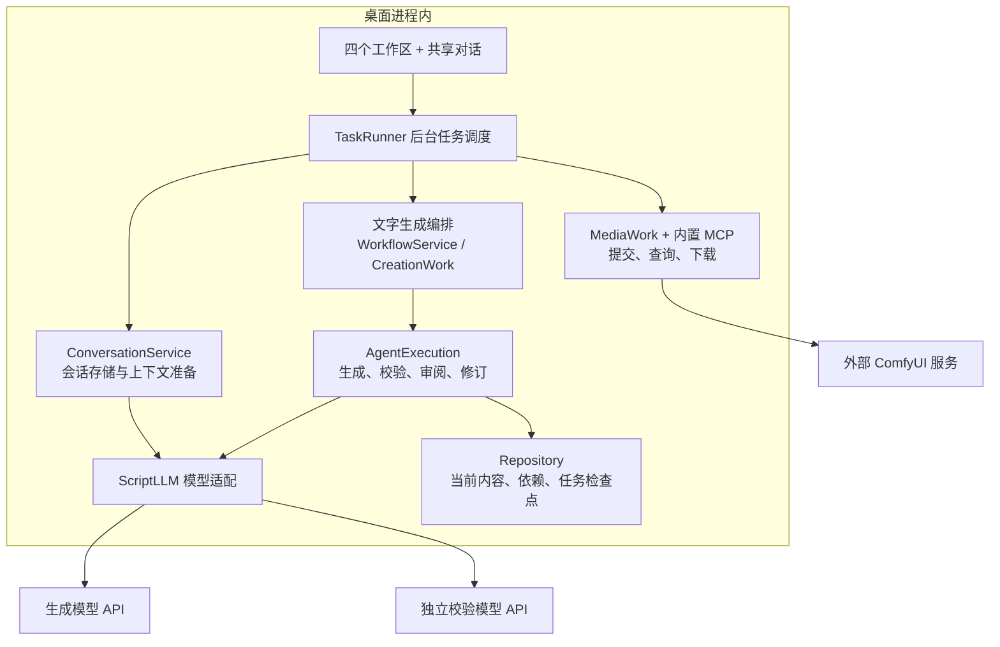
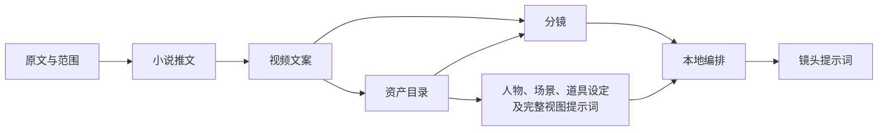
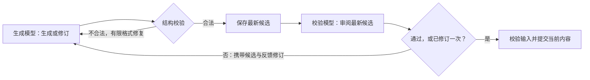

# 短视频工作台：架构设计

文档版本：2.18；日期：2026-11-15。本文说明核心结构与技术决策。
字段与调用见[接口设计](interfaces.md)，界面行为见[交互设计](interaction.md)，代码入口与验证见[开发文档](development.md)。

## 1. 系统结构

Python／PySide6 桌面应用：主线程处理交互，后台线程执行生成任务，数据按项目保存在本地文件中。



| 模块 | 核心职责 |
|---|---|
| Workbench／Editor | 原文、改写、分镜、提示词四个工作区；直接编辑、复制和导出 |
| WorkflowService／CreationWork | 冻结任务输入，编排单阶段、目录＋分镜及资产批次 |
| Runtime／AgentExecution | 控制 Agent Loop、步骤检查点、停止与恢复；业务规则由 validation／review 提供 |
| Repository | 当前内容与来源依赖、原子保存、冲突校验、失效数据清理 |
| ConversationService／Store／Context | 保存会话，筛选完整历史并构造本轮模型输入 |
| MediaService／MediaWork／MCP | 独立管理图片输入、视频任务与远程结果取回 |

## 2. 核心数据流



图示主要产物依赖；原文、配置与规则由编排提供给相应阶段。

- **模型负责生成内容**：两次改写、资产目录、分镜、资产设定与视图。目录由分镜任务内部生成。
- **代码负责确定性处理**：结构和引用校验、时间轴累计、镜头提示词编排、Markdown 导出。
- **Skill 是显式规则输入**：仅用户选中的分镜 Skill 生效，正文随任务冻结，生成、审阅及恢复共用。
- **聊天独立运行**：只使用用户消息和有效会话历史；用户将建议手动修改到右侧文档。

## 3. Agent Loop 与恢复



- **最多修订一次**：首次校验有问题时反馈给生成模型，修订后再次校验；无论第二次是否通过，提交最新合法稿件，残留问题完整保存在 run 与日志中。
- **任务状态与步骤分离**：任务说明执行结果，检查点记录下一步骤、最新候选、待处理回复和修订次数。
- **先保存，再推进**：完整模型回复落盘后再解析，候选落盘后再审阅；提交业务内容时同步更新父任务完成项。
- **从未完成步骤继续**：停止或网络重试耗尽等可恢复失败保留检查点；重启只识别中断，用户点击继续后才执行。已保存回复与已完成资产直接复用。
- **恢复前校验来源与模型**：原文、配置／Skill、模板、上游或人工目标变化使旧任务失效。生成与校验各自冻结模型，校验接口保存指纹；变更后不能混用旧任务。远端结果不明时，重试可能重复计费。

## 4. 存储与一致性

```text
short_video/
├─ project_v2.json     当前索引、tasks、runs、检查点及导出记录
├─ artifacts/         当前内容与未完成任务的临时候选
├─ conversations/     会话消息
├─ plans/             长文分块进度
└─ media/             工作流配置、图片、视频及远程任务记录
```

- **业务内容只保留当前一份**；未完成运行额外保留一个最新临时候选。任务完成、失效或被替代后清理恢复数据。
- **精确依赖与指纹校验**：下游绑定实际来源 ID，上游替换后递归清理失效内容；原文引用使用 Unicode 码点坐标。
- **两级文件锁**：生成锁避免同项目并发执行；项目锁保护清单事务。文件通过原子替换保存，检查点和冻结输入另做完整性校验。

## 5. 外部服务边界

- **文字模型**通过 ScriptLLM 调用；生成与校验使用独立的四字段配置，校验缺失时在生成前提示配置，不回退到生成模型。格式修复与质量修订分别计数，网络异常先在 ScriptLLM 中有限退避重试，耗尽后保留原始错误并交给恢复流程处理。
- **视频生成**使用导入图片及适配后的 API 工作流，经内置 MCP 连接 ComfyUI；工作流、图片、提示词和参数随任务冻结。
- **媒体恢复按远程任务查询**：结果不明时对账，下载失败时重新取回；停止只结束本地等待。此机制与文字检查点恢复分开。

当前提供图片导入、视频生成与播放；资产图片自动生成、视频自动裁切及成片拼接尚未接入。
