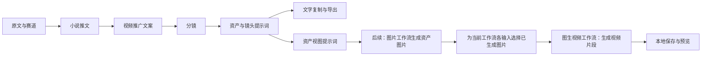
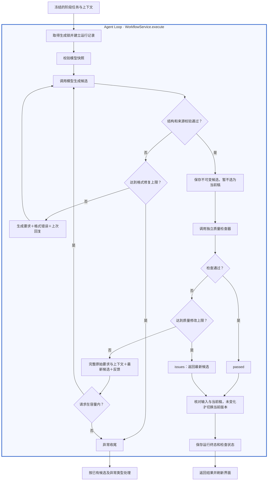
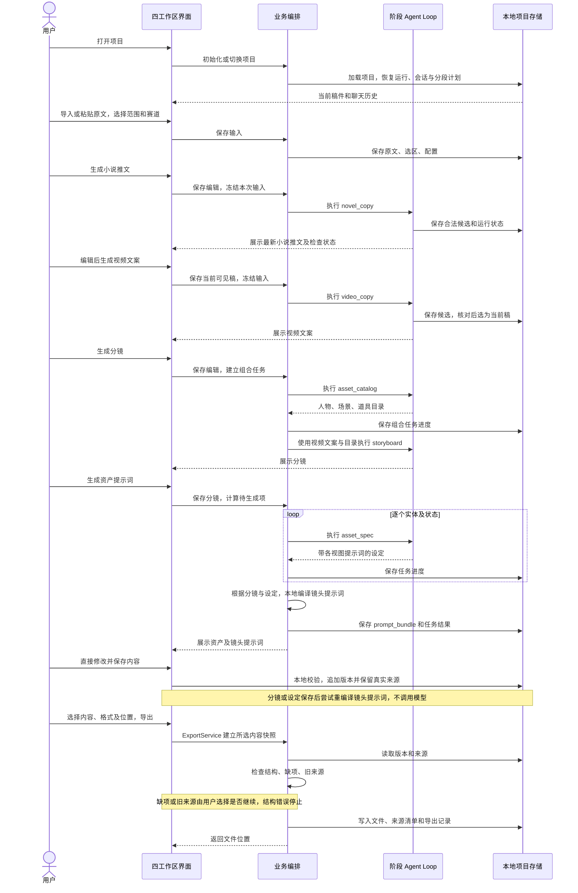
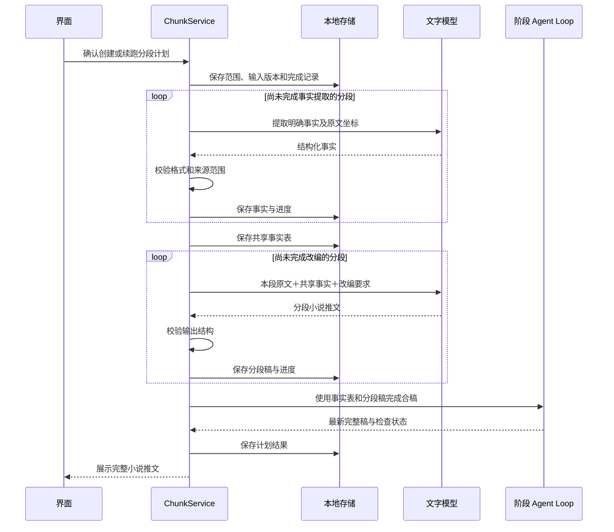
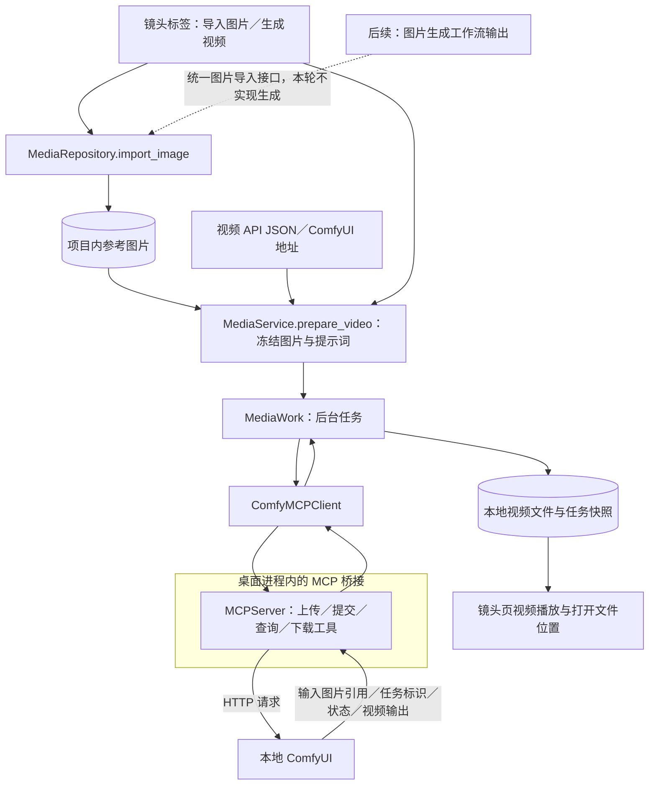

# 网文视频推广工作台：架构设计

文档版本：2.11；日期：2026-11-15；状态：已实现固定 API JSON 多工作流、参考图与首尾帧输入、内置 MCP 视频生成；图片生成仅保留图片导入接口。

关联：[接口设计](interfaces.md)、[交互设计](interaction.md)、[开发文档](development.md)。复用现有 v2 存储和文字服务，当前入口与历史验证见开发文档。

## 1. 产品范围

根据用户提供的文章，完成小说推文、视频推广文案、分镜，以及人物／场景／道具和镜头提示词。保留左侧共享 LLM 对话，支持编辑、复制与 Markdown 文件导出。这些是现有文字能力。

目标链路为资产提示词生成图片，再以图片生成视频。本轮先实现手动导入图片、通过内置 MCP 执行图生视频与本地播放；图片工作流只保留后续取图接口，不执行生成。当前不开发节点编辑器、自动拼接成片或额外图片合成。

用户主要工作是阅读和编辑内容。AI 审阅属于生成任务内部流程；人工阅读不建模成独立审核服务。人物关系和来源绑定属于内部一致性机制，不要求用户操作实体 ID。

## 2. 用户任务与主流程

界面只保留原文、改写、分镜、提示词四个工作区，导出是统一操作。两个改写阶段仍然独立，使用用户原有 Prompt。点击下一步时保存当前可见内容、冻结输入并启动下阶段，取消单独的确认稿件步骤。本轮只在镜头标签接入手动图片与视频；资产标签的图片生成仍待后续，不增加独立工作区。

## 3. 赛道与输入

| 分组 | 选项 |
|---|---|
| 主题 | 脑洞、剧情、奇幻、末世、玄幻、冒险、科幻、豪门 |
| 设定 | 逆袭、系统、穿越、重生、反转、异能、娱乐圈、总裁 |
| 背景 | 异界、都市、校园、架空、年代、职场、古代、乡村、民国 |

原文支持粘贴与 TXT／Markdown，全文或选区；保持来源偏移。赛道可多选，不因标签而伪造原文设定。目标字数与时长可选，不设 90 秒硬上限。超长文本显式缩小范围或分段，不静默截断。

## 4. 模块职责

| 模块 | 职责 |
|---|---|
| Workbench／Editor | 四工作区、直接编辑、共享聊天和统一导出 |
| ProjectService | 导入原文，保存配置、原文与选区，提供原文上下文；媒体任务另由 MediaService 负责 |
| WorkflowService／CreationWork | Agent Loop 组织输入、调用生成、接收检查反馈并控制重试；多阶段编排复用原有冻结输入与完成记录 |
| validation／review.check_candidate | validation 检查结构、来源及关系；check_candidate 将本地问题与任务资料交给 AI 审阅，校验响应后返回是否通过和临时反馈，不触发生成或保存报告 |
| ConversationService | 聊天命令、模型请求与任务状态，不自动附加文档或写入业务内容 |
| ConversationStore／conversation_context | 唯一的会话文件读写、历史筛选、系统规则与容量构造 |
| Repository | 文案／分镜不可变版本、提示词当前内容替换、内部引用、原子保存、冲突与恢复 |
| ScriptLLM | 文字请求、SDK 网络超时、取消和记录 |
| Exporter／PromptCompiler | 自动编译文字，检查结构并导出所选内容 |
| storyboard_text | 将结构化分镜编排为六部分可复制正文，供分镜页剪贴板与 Markdown 导出复用；不调用模型或保存 |

现有实现主要位于 core/short_video/v2/；界面按文章、稿件、对话、导航、公共对话框及编辑器拆为 source_page.py、artifact_page.py、chat_panel.py、workbench.py、ui_helpers.py 、prompt_page.py 和 v2_editor.py。软件保持单进程桌面形态，复用模型配置与任务调度。

已新增的媒体职责如下，文件与验证见[开发文档](development.md)：

| 模块 | 职责 |
|---|---|
| MediaService | 准备视频输入并组织后台执行、跟踪和结果取回；不调用文字质量循环，图片生成未接入 |
| media_workflows | 加载实际导出的工作流与节点映射，只替换声明的输入字段，核对输出节点 |
| ComfyMCPClient | 连接内置 MCPServer，调用本项目的上传、提交、查询、对账及下载工具 |
| MediaRepository | 保存媒体任务、输入快照和本地图片／视频，不承担文字版本管理 |

媒体模块和内置 MCP 桥接都在桌面进程内，外部只需运行 ComfyUI，无需另行安装 MCP 插件。

## 5. 生成 Agent Loop

Agent Loop 在 `WorkflowService.execute` 中实现，不定义业务检查规则。`review.check_candidate` 接收原始阶段要求、必要上下文和候选，复用现有规则及输出校验，返回 `QualityCheckResult(passed, feedback)`；检查器不重新生成、不写入报告。人物、场景、道具与镜头继续使用各自的阶段提示词和规则。

分镜阶段在 prepare 时加载项目内的 [short-video-storyboard Skill](../../core/short_video/v2/skills/short-video-storyboard/SKILL.md)，追加到阶段 instruction 并随原始命令冻结。生成、质量检查和重试使用同一份内容，不额外调用模型或增加循环层。Skill 按视觉节拍、动作、信息识别、对白／旁白及停顿决定拆镜与时长；参考区间允许例外，同长镜头不自动判错。分镜专用检查要求指出具体声画时间冲突和修订办法，结构校验仍只要求正整数时长并累加连续时间轴，不用代码随机修改时长。

`DEFAULT_MAX_RETRIES=2`，`max_retries=N` 表示首次生成后最多再修改生成 N 次；0 表示首次生成并检查后结束。每次重试携带完整原始任务和必要上下文、最新候选与本次反馈。检查通过立即返回；持续不通过时正常返回最新候选，状态为未通过，不回退到较早稿件。未新增 UI 配置。

反馈只在本轮内存中使用，不进入会话历史、问题清单、审核报告或含反馈的运行请求原文。合法候选在进一步付费检查前立即保存，因此中间合法版本也会保留；不能把“反馈不落盘”理解成“候选不落盘”。阶段调用记录只记类型、错误类型和时间，初始命令仍保存原始输入快照。普通聊天和分段提取另有请求记录，不能把这个规则推广到全部模型调用。

`status=succeeded` 只表示阶段已返回可用结果，质量另由 `review_status` 表示：passed、issues、unavailable。已有合法候选时，文字服务异常、可处理的格式或上下文错误标记 unavailable；没有合法候选则失败并保留原稿。取消、存储失败及其他内部异常停止执行，不触发质量重试。历史 incomplete 状态仍可读取。结果提交前再次核对输入和当前稿，冲突时仅保留候选，不覆盖其他修改。图中的重复请求在建立运行记录时直接返回原结果；异常和取消分支不展开到每个节点。

格式错误最多修复两次，与质量修改次数分别计数，不设置总请求次数和整轮时限。结构合法的最新内容可直接编辑、继续或导出；人工保存不触发 Agent Loop。普通讨论仅使用用户消息和会话历史；不自动附带文档或发送前保存，对话不进入内容质量检查。

## 6. 自动维护依赖

生成分镜内部提取资产目录，维护稳定人物、场景、道具 ID；生成提示词内部准备设定与各视图。用户不必分别提取、确认、绑定和编译。

明确身份和别名自动处理；存在会影响故事的歧义时只询问该处事实，保留其余成果。人物、场景和道具仍以可读内容供编辑，不能因为隐藏绑定入口而取消一致性约束。

人物四视图共享身份服饰描述；场景多角度共享布局；道具多角度共享结构与状态。asset_spec 一次调用生成统一基础设定及完整视图提示词；程序校验字段、计划视图和资产身份，再规范视图顺序与内部指纹，不用模板重写模型文字。后续图片生成将读取具体 view 的正负提示词，当前只保留完整图片导入接口，不执行此链路。未明外观和布局基准可作为设计补充列入 inferred_fields，不伪称原文事实，也不默认变成人工审批清单。

资产质量检查对照原文、基础设定和整组视图，分别检查人物朝向与可见性、场景固定布局与摄影机位置、道具结构与可见表面。检查指出具体字段路径、矛盾和修改建议，沿用现有 Agent Loop 重新生成完整资产；这是文字自洽性检查，不代表实际图片已经验证。资产视图只保留模型生成路径，旧模板编译及单独视图优化入口已删除；镜头提示词继续本地编排。

## 7. 保存、来源和导出

项目在所选目录的 `short_video/` 下保存数据：`project_v2.json` 保存内容索引、current 指针、运行与导出记录，`artifacts/` 保存内容，`tasks/` 保存组合任务，`conversations/` 保存聊天，分段计划由 batches 管理。文案、分镜等保留不可变历史；提示词按对象与状态仅保留当前一份，新结果采用新文件原子提交后删除旧提示词文件，不保留父版本链。生成期间临时保留原稿与候选，任务结束后清理中间候选；失败或取消保留原稿。替换资产提示词后，清除依赖被替换内容的镜头提示词并重新编排，不能留下悬空引用。旧 confirmation 数据可保留但不作为新流程门槛；读取仍要求当前有效结构，不承诺任意旧格式自动迁移。

打开工作台时的恢复步骤会清理已有项目中非当前的提示词及相关历史检查记录；普通 load／record 仍只读。已完成的提示词运行不再保存完整生成命令和旧提示词正文。当前提示词不再递归显示上游版本过期状态，重新生成直接使用当前分镜对应的资料，不要求选择历史提示词；内部来源绑定仍用于结构校验。

下游引用实际使用的版本。上游编辑后提示下游基于旧内容；用户重新生成或明确沿用旧稿。沿用旧稿保留旧依赖，不伪造绑定到新来源。

内部检查状态与任务状态独立；主界面通常只显示保存和运行状态。人工审核记录、本期不需要的处理理由或评分不再新增。

导出当前所选文案、分镜或提示词，自动验证结构和文件写入。允许仅导出已有内容；缺项明确说明。取消确认所有阶段、接受所有 warning 才允许导出的规则。

分镜的主交付为“视觉风格、场景概述、逐镜时间段、镜头要求、音频、限制”的整段文本，分镜页直接复制当前编辑。文件仅导出 Markdown，使用段落正文。内部仍按结构化镜头保存，编辑、实体关系和时间轴校验继续使用原数据。

媒体保存在同一项目的 `short_video/media/` 下：`settings.json` 保存配置，`jobs/` 保存任务，`images/` 保存导入图片，`videos/` 保存视频；未新增 index.json。正文提示词仍只保留当前一份，媒体任务独立保存实际输入和哈希。二进制不嵌入文字清单，具体契约见[接口设计第 10 节](interfaces.md#10-comfyui-mcp-媒体接口)。

## 8. 实施边界

现有实现包括 Agent Loop、四工作区、内部资产编排和按所选内容导出。开发过程与历史验证记录统一见根目录 [开发日志](../../DEVLOG.md)。本轮落地图生视频，图片生成暂未接入；不增加人工审计、人物绑定管理或独立检查页面。

不设置总请求次数、任务总时长或单次请求的 120 秒墙钟上限。网络连接和读写沿用 SDK 自身超时；SDK 自动重试关闭。质量修改默认两次，每次候选生成的格式修复也最多两次；单个长文分块允许一次格式修复。调用次数和耗时仅作运行记录，不影响是否继续。

分镜先提取目录再生成镜头；资产任务逐项处理；长文分段继续复用已完成内容，旧计划的历史预算字段只参与旧哈希核验，不限制执行。普通聊天发送一次。镜头初次编译为本地代码；用户优化镜头提示词进入单阶段循环。待生成资产排除仅画外音人物，复用目录一致且本地检查无错误的已有设定。

## 9. 主业务时序与子系统展开

以下展示正常路径；“业务编排”合并表示 Workbench、后台调度与 CreationWork，并非新增服务。每个下一阶段都由用户点击启动。异常按第 5 节收尾，聊天展开见[会话管理](conversation_management.md#聊天时序图)，导出与保存入口见[接口设计](interfaces.md)。

长文路径由用户选择启用，续跑只复用输入仍有效的已完成分段，不自动重发：

阶段生成规则以 `workflow.py`、组合编排以 `creation.py`、分段实现以 `batches.py` 为准。原文和稿件的业务来源依赖与纯聊天历史是两套数据关系，不能相互自动注入。

## 10. ComfyUI MCP 媒体子系统

### 10.1 本轮范围与实际结构

本轮先完成手动图片输入与视频工作流：不依赖原文、分镜或完整资产提示词，即可在“提示词 → 镜头”导入图片，修改可见的视频提示词并生成视频。图片生成暂未接入；后续取回的资产图片可通过同一个 import_image 接口加入媒体库，当前不执行生图。

MCP 客户端和服务端使用官方 Python SDK 在进程内连接，随软件创建和关闭，无独立端口、子进程或待用户部署的外部 MCP 服务。桥接再访问配置的 ComfyUI 地址。文字 Agent Loop 与纯聊天不调用这些工具，GPU 工作不进入文字质量修复循环。

### 10.2 工作流适配

配置保存命名的工作流列表、每份 API JSON 和当前选择。用户通过粘贴 JSON 新增或更新固定工作流；生成界面不增加节点、不修改连线。软件从唯一 SaveVideo 反向裁剪有效依赖，孤立图片节点不显示、不提交。

当前适配两类 MiniMax H3 模板：

| 模板 | 图片关系 | 已提供资源 |
|---|---|---|
| 参考图 | MiniMaxH3ReferenceToVideo.ref_images.ref_image_N 直接连接的独立 LoadImage，按 N 排序 | minimax_h3_reference.json，默认连接 137／139／147 三张参考图；更新连线数量后 UI 同步变化 |
| 参考图＋首尾帧 | MiniMaxH3ReferenceToVideo 的 3 张参考图，加上顺序连接的 MiniMaxH3AddGuide（frame_idx = 0／-1） | minimax_h3_first_last.json，用户提供的实际工作流，显示参考图 1～3、首帧和尾帧 |

首尾帧资源现以用户提供的 MiniMaxH3_多参考图_已连接首尾帧_完整示例.json 为准，保留 ref2va 模型与其采样分支。参考图作为外观条件，两个 AddGuide 分别传入首帧和末帧引导条件；尾帧引导的条件输出连接最终采样器。已有 MiniMaxH3ImageToVideo 独立首尾帧配置继续支持。自带副本仅将 CreateVideo.chroma_subsampling 从当前 ComfyUI 不接受的 none 改为 auto，不修改用户源文件。 当前 5 秒复测已跑通生成与播放，但严格首帧画面控制未通过；连接正确不表示模型一定严格复现输入首尾帧，具体观察见开发文档。

模板适配还确定提示词入口和时长、随机种子、分辨率及采样等参数。界面按参数类型显示控件；只有公开参数、每张图片的服务器返回引用、可见提示词和本轮输出前缀写入 JSON 副本，其余模型设置与连线保留。时长仍按模板内 24 fps 与帧数网格换算，实际视频时长可能略有差异。其他模型或图片预处理拓扑尚未适配时明确报错。

### 10.3 存储、状态与恢复

媒体保存在项目的 short_video/media/：settings.json 为地址、工作流 JSON 列表及当前工作流标识，images/ 为导入图片及来源记录，jobs/ 为不可变输入快照和执行状态，videos/ 为完整视频文件。没有媒体目录的旧项目只读打开，不修改文字 schema，不另建当前指针索引。

任务保留工作流标识及名称、各图片输入与哈希、公开参数、实际提示词、目标镜头（可空）、原工作流、提交工作流及远程任务标识。每个新任务采用独立文件名，界面按所选工作流和全部图片输入展示最新任务。提示词替换不会删除媒体记录；修改生成输入不会改写已提交的任务快照。

正常状态为 prepared → submitting → queued/running → collecting → succeeded。提交只执行一次；响应丢失进入 unknown，可按请求标记在远程队列／历史中查找原任务。查询不到时保持未知，不自动再发。远程完成后下载失败可重新获取结果，不重跑模型。

停止只结束本地等待，已提交任务标记 interrupted；不向共享 ComfyUI 发送全局 interrupt。重新打开可查询原任务，既不自动续跑，也不重新提交。没有总请求预算或任务总时限；HTTP 单次连接、读写仍有网络超时。

实际链路依据[ComfyUI 官方服务接口](https://docs.comfy.org/development/comfyui-server/comms_routes)与[API 工作流示例](https://docs.comfy.org/development/comfyui-server/api-examples)；内置 MCP 连接方式参见[官方 Python SDK 客户端说明](https://github.com/modelcontextprotocol/python-sdk/blob/main/docs/client/transports.md)。验证结果见开发文档。
