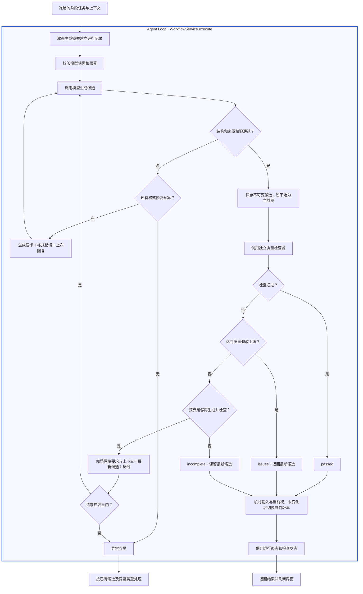
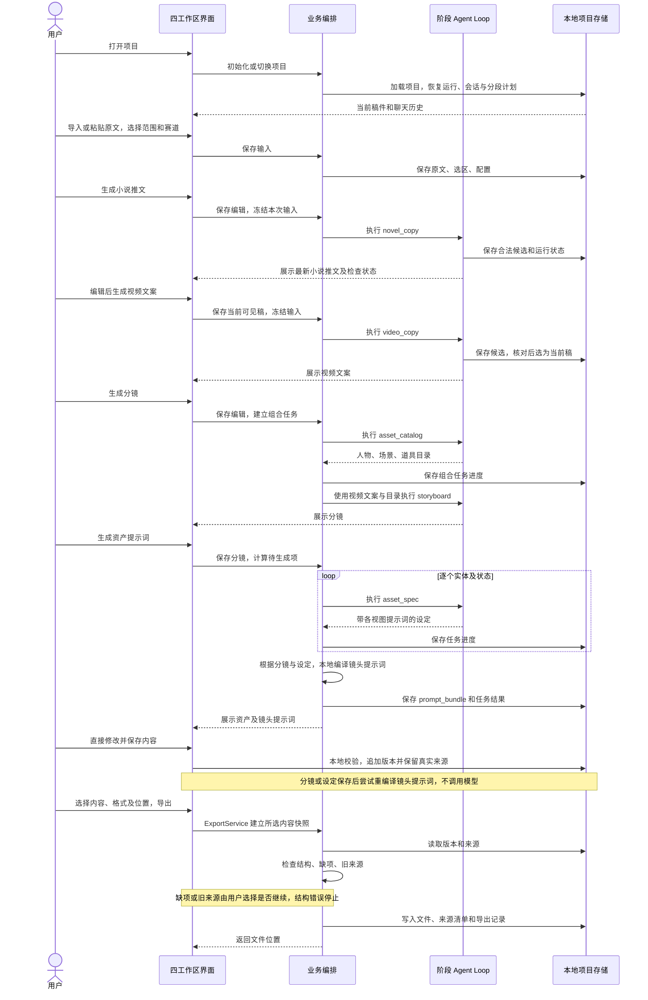
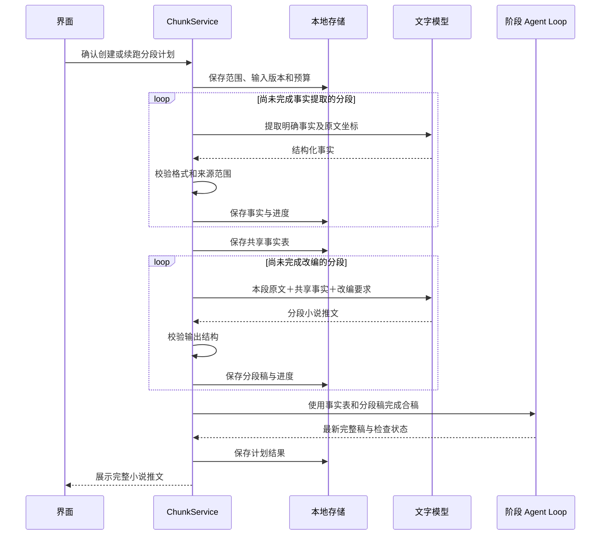

# 网文视频推广工作台：架构设计

文档版本：2.4；日期：2026-11-03；状态：按当前 v2 源码核对。本文版本不改变项目 schema_version=2。

关联：[接口设计](interfaces.md)、[交互设计](interaction.md)、[开发文档](development.md)。复用现有 v2 存储和文字服务，当前入口与历史验证见开发文档。

## 1. 产品范围

根据用户提供的文章，完成小说推文、视频推广文案、分镜，以及人物／场景／道具和镜头提示词。保留左侧共享 LLM 对话，支持编辑、复制、XLSX／CSV 与文字包导出。当前范围只生成文字，实际图片和视频由外部工具制作。

用户主要工作是阅读和编辑内容。AI 审阅属于生成任务内部流程；人工阅读不建模成独立审核服务。人物关系和来源绑定属于内部一致性机制，不要求用户操作实体 ID。

## 2. 用户任务与主流程

界面只保留原文、改写、分镜、提示词四个工作区，导出是统一操作。两个改写阶段仍然独立，使用用户原有 Prompt。点击下一步时保存当前可见内容、冻结输入并启动下阶段，取消单独的确认稿件步骤。

## 3. 赛道与输入

| 分组 | 选项 |
|---|---|
| 主题 | 脑洞、剧情、奇幻、末世、玄幻、冒险、科幻、豪门 |
| 设定 | 逆袭、系统、穿越、重生、反转、异能、娱乐圈、总裁 |
| 背景 | 异界、都市、校园、架空、年代、职场、古代、乡村、民国 |

原文支持粘贴与 TXT／Markdown，全文或选区；保持来源偏移。赛道可多选，不因标签而伪造原文设定。目标字数与时长可选，不设 90 秒硬上限。超长文本显式缩小范围或分段，不静默截断。

## 4. 模块职责

| 模块 | 职责 |
|---|---|
| Workbench／Editor | 四工作区、直接编辑、共享聊天和统一导出 |
| ProjectService | 保存输入、选择当前稿、管理项目 |
| WorkflowService／CreationWork | Agent Loop 组织输入、调用生成、接收检查反馈并控制重试；多阶段编排复用原有冻结输入与任务预算 |
| validation／review.check_candidate | validation 检查结构、来源及关系；check_candidate 将本地问题与任务资料交给 AI 审阅，校验响应后返回是否通过和临时反馈，不触发生成或保存报告 |
| ConversationService | 聊天命令、模型请求与任务状态，不自动附加文档或写入业务内容 |
| ConversationStore／conversation_context | 唯一的会话文件读写、历史筛选、系统规则与容量构造 |
| Repository | 不可变版本、内部引用、原子保存、冲突与恢复 |
| ScriptLLM | 文字请求、预算、超时、取消和记录 |
| Exporter／PromptCompiler | 自动编译文字，检查结构并导出所选内容 |

现有实现主要位于 core/short_video/v2/；界面按文章、稿件、对话、导航、公共对话框及编辑器拆为 source_page.py、artifact_page.py、chat_panel.py、workbench.py、ui_helpers.py 、prompt_page.py 和 v2_editor.py。软件保持单进程桌面形态，复用模型配置与任务调度。

## 5. 生成 Agent Loop

Agent Loop 在 `WorkflowService.execute` 中实现，不定义业务检查规则。`review.check_candidate` 接收原始阶段要求、必要上下文和候选，复用现有规则及输出校验，返回 `QualityCheckResult(passed, feedback)`；检查器不重新生成、不写入报告。人物、场景、道具与镜头继续使用各自的阶段提示词和规则。

`DEFAULT_MAX_RETRIES=2`，`max_retries=N` 表示首次生成后最多再修改生成 N 次；0 表示首次生成并检查后结束。每次重试携带完整原始任务和必要上下文、最新候选与本次反馈。检查通过立即返回；持续不通过时正常返回最新候选，状态为未通过，不回退到较早稿件。未新增 UI 配置。

反馈只在本轮内存中使用，不进入会话历史、问题清单、审核报告或含反馈的运行请求原文。合法候选在进一步付费检查前立即保存，因此中间合法版本也会保留；不能把“反馈不落盘”理解成“候选不落盘”。阶段调用记录只记类型、错误类型和时间，初始命令仍保存原始输入快照。普通聊天和分段提取另有请求记录，不能把这个规则推广到全部模型调用。

`status=succeeded` 只表示阶段已返回可用结果，质量另由 `review_status` 表示：passed、issues、unavailable、incomplete。已有合法候选时，文字服务异常标记 unavailable，预算耗尽标记 incomplete，可处理的格式或上下文错误标记 unavailable；没有合法候选则失败并保留原稿。取消、存储失败及其他内部异常停止执行，不触发质量重试。结果提交前再次核对输入和当前稿，冲突时仅保留候选，不覆盖其他修改。图中的重复请求在建立运行记录时直接返回原结果；异常和取消分支不展开到每个节点。

生成模型的结构无效输出仍按现有格式修复能力处理，并消耗同一调用预算；它不是质量检查不通过。结构合法的最新内容可直接编辑、继续或导出；人工保存不触发 Agent Loop。普通讨论沿用现有对话流程，仅使用用户消息和会话历史；已移除文档引用、页面联动及发送前自动保存。对话不进入内容质量检查，不新增数据库或运行存储。

## 6. 自动维护依赖

生成分镜内部提取资产目录，维护稳定人物、场景、道具 ID；生成提示词内部准备设定与各视图。用户不必分别提取、确认、绑定和编译。

明确身份和别名自动处理；存在会影响故事的歧义时只询问该处事实，保留其余成果。人物、场景和道具仍以可读内容供编辑，不能因为隐藏绑定入口而取消一致性约束。

人物四视图共享身份服饰描述；场景多角度共享布局；道具多角度共享结构与状态。未明外观可作为设计补充，不伪称原文事实，也不默认变成人工审批清单。

## 7. 保存、来源和导出

项目在所选目录的 `short_video/` 下保存数据：`project_v2.json` 保存版本索引、current 指针、运行与导出记录，`artifacts/` 保存不可变内容，`tasks/` 保存组合任务，`conversations/` 保存聊天，分段计划由 batches 管理。旧 confirmation 数据可保留但不作为新流程门槛；读取仍要求当前有效结构，不承诺任意旧格式自动迁移。

下游引用实际使用的版本。上游编辑后提示下游基于旧内容；用户重新生成或明确沿用旧稿。沿用旧稿保留旧依赖，不伪造绑定到新来源。

内部检查状态与任务状态独立；主界面通常只显示保存和运行状态。人工审核记录、本期不需要的处理理由或评分不再新增。

导出当前所选文案、分镜或提示词，自动验证结构和文件写入。允许仅导出已有内容；缺项明确说明。取消确认所有阶段、接受所有 warning 才允许导出的规则。

## 8. 实施边界

本轮实现Agent Loop、四工作区、内部资产编排和按所选内容导出。开发过程与历史验证记录统一见根目录 [开发日志](../../DEVLOG.md)。未新增人工审计、绑定管理或媒体接口。

| 入口 | 当前默认请求上限 | 总时限 |
|---|---|---|
| 单阶段生成／重新生成 | 6 次，即 2 × (1 + max_retries)，默认 max_retries=2 | 300 秒 |
| 分镜组合任务：目录＋分镜 | 12 次，两阶段共用预算 | 600 秒 |
| 资产提示词组合任务 | max(1, 6 × 待生成项数) 次 | min(1800, max(300, 300 × 项数)) 秒 |
| 长文分段计划 | 4 × 段数 + 6 次，续跑扣除已用次数 | min(1800, 300 × (2 × 段数 + 1)) 秒 |
| 普通聊天 | 1 次 | 120 秒 |

单次网络请求最多 120 秒，并受剩余总时限约束；SDK 自动重试关闭。格式修复和失败请求消耗同一预算，不能保证一定完成三轮质量检查。镜头初次编译为本地代码，不计模型请求；用户优化镜头提示词则进入单阶段循环。待生成资产排除仅画外音人物，复用目录一致且本地检查无错误的已有设定。

## 9. 主业务时序与子系统展开

以下展示正常路径；“业务编排”合并表示 Workbench、后台调度与 CreationWork，并非新增服务。每个下一阶段都由用户点击启动。异常按第 5 节收尾，聊天展开见[会话管理](conversation_management.md#聊天时序图)，导出与保存入口见[接口设计](interfaces.md)。

长文路径由用户选择启用，续跑只复用输入仍有效的已完成分段，不自动重发：

阶段生成规则以 `workflow.py`、组合编排以 `creation.py`、分段实现以 `batches.py` 为准。原文和稿件的业务来源依赖与纯聊天历史是两套数据关系，不能相互自动注入。
