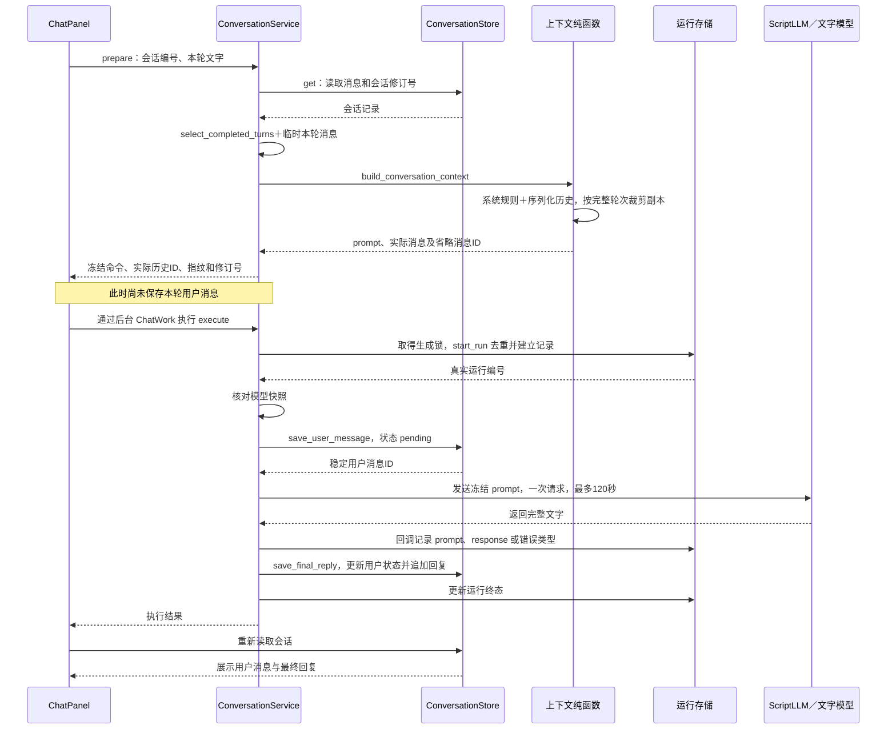

# 会话管理：纯聊天存储与上下文构造

文档版本：2.4；更新日期：2026-11-03；按当前源码核对。范围为纯聊天：不存储或解析新引用，不自动附加项目文档。

## 实现与边界

| 模块 | 职责 |
|---|---|
| `core/short_video/v2/conversation_store.py` | 保存／读取用户消息与最终回复，提供包含本轮用户消息的历史 |
| `core/short_video/v2/conversation_context.py` | 整理历史、补充系统规则、按字符容量构造本次请求副本 |

继续使用 `short_video/conversations/{conversation_id}.json`，复用项目身份、既有文件锁与 `atomic_write_text`，不新增数据库或存储格式。新消息只保存文本、身份、状态、时间及模型快照，不保存引用记录、检查反馈或中间候选。不批量改写历史文件；历史中的额外引用／反馈元数据不会进入新上下文。

现有聊天入口已接入这两个模块。`ConversationService` 负责准备执行命令、模型请求与任务终态，不直接读写会话文件或拼接上下文；预检使用存储模块提供的 `select_completed_turns` 纯函数筛选历史。界面和文字评估入口通过 `service.store` 访问会话，旧的 create/get/list/_path/_update 方法已删除，不保留兼容别名。普通聊天不进入质量检查 Agent Loop，内容生成的循环另见[架构设计](architecture.md#5-生成-agent-loop)。

## 存储接口

`ConversationStore(repository)` 的全部操作只访问本地文件。模型快照由调用方提供，不读取模型配置、不调用 LLM。

| 接口 | 输入与结果 |
|---|---|
| `create(title="新对话")` | 建立会话，返回会话对象；空项目只建立项目身份，不创建文章或工作稿 |
| `get(conversation_id)` / `list()` | 读取会话／按更新时间倒序列出会话，返回独立对象 |
| `save_user_message(conversation_id, user_text, *, turn_id, model_snapshot, expected_revision=None)` | 保存本轮用户消息为 `pending`，返回带稳定 ID 的消息 |
| `save_final_reply(conversation_id, user_message_id, final_reply, *, status="complete", expected_revision=None)` | 接收非空最终回复文本，原子地完成用户消息并追加对应 `assistant` 回复；停止时已完整返回的回复以 cancelled 状态保留 |
| `finish_without_reply(conversation_id, user_message_id, status, *, expected_revision=None)` | 未取得最终回复时标记 `failed`、`cancelled` 或 `interrupted`，不伪造回复 |
| `get_history(conversation_id, *, current_message_id)` | 返回此前完整用户／最终回复轮次，加上本轮用户消息 |
| `recover(active_turn_ids)` | 将无活动任务对应的 pending 消息标为 interrupted，不重发请求；重复恢复不改写已恢复文件 |

同一轮次不能重复保存用户消息，一次只能有一个未完成轮次；同一用户消息不能重复追加回复。可选 `expected_revision` 提供修订号冲突检查，既有文件锁保护实际读写。保存冲突或磁盘写入失败不覆盖原文件，原始运行异常向能够反馈的调用方传播。

历史按消息身份和轮次整理，不根据文本去重：不同轮次重复提问保留。取消、失败、中断及没有完整最终回复的历史轮次不进入请求历史。本轮即使已经完成，再次获取该轮历史时也只包含本轮用户消息，不加入其答案或后续消息。返回对象与磁盘记录独立。

只有用户消息与最终回复的存储接口，没有追加任意角色、候选或检查结果的接口。调用方必须在最终回复确定后调用 `save_final_reply`，不能把草稿作为最终回复提交；候选和反馈保留在执行方的本轮内存中。

## 上下文接口与容量策略

`build_conversation_context(history, current_message_id, *, system_rules=DEFAULT_SYSTEM_RULES, max_context_chars=48000) -> ConversationContext` 是纯函数，不读写文件、不解析引用、不请求模型。

输入 `history` 使用存储模块提供的完整轮次及末尾本轮用户消息。默认系统规则与当前纯聊天规则一致；业务规则可由调用方显式传入非空文本。

结果包含：

- `prompt`：系统规则加上唯一的 `conversation` 消息数组。
- `messages`：本次实际使用的消息副本，只含消息身份、角色、文字、状态与必要父消息关系。
- `omitted_message_ids`：因容量裁掉的历史消息 ID。
- `character_count`：最终请求文本的字符数。

本轮用户消息已在历史中，不再追加一遍，也不额外添加 `user_message` 字段。同一消息 ID 的相同记录只使用一次；同一 ID 对应不同消息内容时报错。不同 ID 的相同文字仍然保留。

从输入消息中只选取上述必要字段；旧的引用、检查反馈和候选元数据既不进入 `prompt`，也不进入结果 `messages`。消息正文始终作为 JSON 数据序列化，不根据正文中的类似角色标记拼接系统规则。

容量单位为最终 `prompt` 的 Python Unicode 字符数，包含系统规则与 JSON 格式，**不是 token 数**：

1. 始终保留系统规则和本轮完整用户消息。
2. 超限时从最早完整的用户／最终回复轮次开始裁剪输入副本，保留最近连续历史，不留下孤立回复。
3. 刚好等于上限可用；系统规则和本轮消息仍超限时抛出 `CONTEXT_TOO_LARGE`，给出 `required_chars` 与 `max_context_chars`，由调用方缩短消息。
4. 不截断系统规则或本轮消息，不将裁剪结果写回会话，不修改原始历史。

## 独立调用示例

```python
from core.short_video.v2.conversation_store import ConversationStore
from core.short_video.v2.conversation_context import build_conversation_context
from core.short_video.v2.models import identity
from core.short_video.v2.repository import ProjectRepository

repository = ProjectRepository(project_directory)
store = ConversationStore(repository)
conversation = store.create("剧情讨论")
user = store.save_user_message(
    conversation["id"],
    "怎样写一个紧凑的开头？",
    turn_id=identity("run"),
    model_snapshot={"provider": selected_provider, "model": selected_model},
)
history = store.get_history(conversation["id"], current_message_id=user["id"])
context = build_conversation_context(history, user["id"])

# 本模块至此输出 context；最终回复由外部执行方产生。
store.save_final_reply(conversation["id"], user["id"], final_reply)
# 若没有最终回复，改用 finish_without_reply(..., "failed" / "cancelled" / "interrupted")。
```

## 当前入口与执行顺序

界面通过 `ChatPanel.service().store` 创建、读取和选择会话；发送使用 `ConversationService.prepare/execute`，工作线程继续使用 `ChatWork`。

1. prepare 读取会话，使用唯一的 `select_completed_turns` 筛选此前完整轮次，加入本轮临时消息副本，由 `build_conversation_context` 处理容量。预检只读，不提前写入消息；容量或配置错误不会遗留 pending 消息。
2. 命令冻结实际历史 ID、上下文指纹及会话修订号。prompt 只有一个 conversation 数组，本轮用户消息出现一次。
3. execute 取得实际运行 ID 后通过 store 保存本轮用户消息，再调用文字服务。相同请求命令沿用现有任务去重，不重复请求或追加消息；修订号冲突不覆盖其他窗口保存的消息。
4. 有最终回复时调用 save_final_reply；停止期间已经完整返回的回复保留为 cancelled，之后的历史会过滤该轮。没有回复则调用 finish_without_reply 关闭失败／取消轮次。运行记录写入失败时不把已经保存的最终回复改写为失败消息。
5. 启动恢复先使用现有项目恢复，再调用 store.recover，只调整未完成消息状态，不补发模型请求。

会话文件操作仅在 ConversationStore；完整轮次筛选只有 select_completed_turns 一处实现；上下文规则、序列化和容量处理只在 conversation_context。共享入口接入已完成，旧存储和旧上下文代码已删除，没有双写或备用旧分支。

## 聊天时序图

prepare 使用临时本轮消息构造只读预检；execute 取得真实 run_id 后才保存稳定消息 ID。执行发送的是已冻结 prompt，不需要在落盘后再次拼接本轮消息。下面展示正常成功路径，后台 ChatWork 折叠在执行箭头中。



失败／取消没有取得回复时使用 finish_without_reply；完整回复已经返回则先保存，再检查取消，取消轮次不进入后续历史。若回复已保存但运行终态写入失败，不能回头将回复改为失败或再次请求。UI 的重试只恢复输入文字，不直接发送。当前模型返回和 UI 均不是流式展示。

会话存储写入链：取得文件锁 → 读取并检查修订号 → 修改副本 → 同目录临时文件写入、flush 和 fsync → os.replace → 返回独立对象。失败不把临时文件当成有效会话。启动时先恢复项目运行，再传入实际活动轮次集合调用 store.recover，不主动重发。

会话文件与运行记录职责不同：会话保存用户文字和最终回复；现有运行命令记录本次 prompt、历史 ID 和上下文指纹，calls 记录实际 prompt／response／error。它们不包含自动项目引用，也不包含生成循环的检查反馈；不能宣称整个项目只保存最终回复。

## 验证方法

独立测试：`python -m pytest tests/test_conversation_management.py -q --tb=short`。

覆盖 JSON 往返、最终回复、历史过滤、本轮去重、重复文本、系统规则、精确容量边界、完整轮次裁剪、超限时保留原数据、并发写入、修订冲突、原始文件异常、坏文件、项目隔离及旧引用／反馈元数据过滤。完整管理流程在禁止读取模型配置和禁止构造 SDK 客户端时仍可执行，无需启动 Agent Loop。

## 历史验证记录

以下保留此前会话实现阶段的记录，非本次 2.4 文档修订复跑结果：存储、聊天入口和契约 70 项通过（3.97 秒）；Qt 界面、SDK 数据流和模型配置 31 项通过（30.72 秒），包括真实“发送”按钮触发长历史裁剪、消息落盘和停止后保留回复。全量回归 1179 passed、5 subtests passed（147.68 秒），运行期间相关源码与测试指纹一致。全量完成后仅清理评估入口残留的旧引用参数，并补充实际 CLI 调用验证，聊天定向回归 8 项通过（1.21 秒）。不把这些记录合并成新的全量通过数。

Ruff、29 个相关文件格式、compileall、差异和文档链接检查通过。workflow.py、review.py、creation.py、llm.py、contracts.py、repository.py 的前后 SHA-256 一致。全部使用临时项目和离线替身，未发送真实模型请求、未修改用户会话文件。证据：`quality_runs/conversation_cleanup_20261103/verification.json`。
