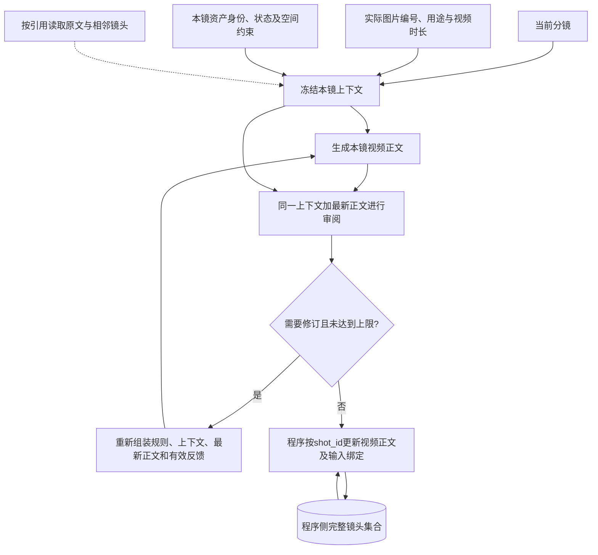

# 单镜头视频提示词上下文

日期：2026-11-16。第一版使用已有引用读取资料，复用现有文字 Agent Loop，不增加检索模型调用。

## 数据流

当前分镜、实际选图和本镜相关资产组成冻结的事实资料；程序按本镜 `source_refs` 读取原文，补充前后各一个镜头的衔接字段。生成、独立审阅和质量修订共享该事实资料。模型只返回当前镜头结果，完整镜头集合由程序维护。



“重新组装修订请求”指 AI 审阅后的自动质量修订。人工修改分镜、资产、选图或工作流会使旧输入失效，需要重新准备任务。

## 资料与模型协议

- 原文按原始 Unicode 码点坐标读取，合并重叠范围；正文仅在 `segments[].text` 出现一次。
- 补充资料含原文及相邻镜头的动作、场景、人物与道具引用，不包含邻镜提示词。补充上限为 `min(6000, max_context_chars // 4)` 个序列化字符，依次尝试原文、前镜、后镜；无法容纳的完整项省略并标记，不截断原文或回退到全文。完整省略坐标保留在程序侧 `supplement_manifest`。
- 模型看到单镜头、统一资产列表、实际视频输入、有限补充资料及必要配置要求；完整集合、版本控制、图片哈希和提交绑定保留在程序侧。手动图片未确认来源时不推断身份。
- 初次请求优先采用非空人工编辑正文，否则采用该镜头已有正文，作为一次出现的措辞参考。修订只带最新正文和本轮反馈。
- 生成与格式修复均只返回以下两字段，不接受完整集合、其他镜头或额外字段：

```json
{"shot_id":"当前镜头ID","video_motion_prompt":"含声音和负面约束的完整中文视频正文"}
```

审阅仅接收审阅标准、任务要求、同一本镜上下文及最新正文。沿用 `issues` 结构，`target_path` 限定为 `video_motion_prompt`，程序将其转换到完整集合的对应镜头路径。引文必须位于本次实际提供的原文范围。

审阅请求增加“输出结构约束”分块，包含公共审阅Schema的视频派生规则与一份合法结构示例，
不重复本镜资料或完整镜头集合。Schema、示例和格式反馈均计入冻结的输入预算。
先解析JSON并完成结构和原文业务检查，再添加内部字段及转换镜头路径；报告错误分类为
syntax、schema、reference，携带具体位置或字段路径，不预设错误原因，不自动改写正文。

## 合并、预算和恢复

局部结果在程序侧合入未采用的完整候选，以复用原有校验及检查点；最终事务才替换当前版本。仅更新目标镜头的 `video_motion_prompt` 和代码维护的 `video_prompt_binding`，其余字段、镜头和引用保持原样。每次请求及提交前验证输入仍有效。

默认输入预算仍为48,000字符；预算随新任务冻结，恢复不受新服务实例默认值影响。生成、审阅、修订和格式修复均在发送前检查完整请求。运行调用记录保存总字符数、分块大小和省略项数。字符预算不是模型 token 上限，接口原始错误继续保留。

超预算停止发送，保留原稿、检查点、已有候选和完整反馈；原资料与冻结预算不变时，点击继续仍会在本地阻断，不产生额外模型调用，应缩小资料后准备新任务。审阅网络中断可直接恢复审阅，不重复生成。

质量修订默认最多一次；达到上限仍有提醒则保存最新合法候选，标记 `review_status="issues"`。每稿生成回复和每轮审阅回复各允许一次格式反馈修复，分别使用生成API和校验API；错误、原始回复及本镜资料一并反馈，修复后再次解析。审阅修复使用独立检查点，不占质量修订次数，中断恢复不重置额度。修复仍失败则停止，原稿不替换，不以审阅通过或质量提醒状态提交。所有修复请求仍检查输入预算，网络重试沿用既有策略。

视频提示词只有当前单镜头协议，不保留专用协议版本标记、旧版生成／审阅／回退或旧任务迁移代码。入口直接校验本镜资料、选中镜头和输入预算；不完整任务不能发送或继续。恢复只读取当前项目清单中的任务，不扫描、导入或清理独立任务文件；项目必须具备当前运行存储字段，不自动补齐旧格式。业务内容继续使用完整 `prompt_bundle`，左侧画面提示词的本地编排保持现状。

## 验收

`tests/test_video_prompt.py` 覆盖：无关镜头从2个增加到35个时三阶段请求长度不变；精确坐标与重叠去重；宽引用省略；生成、审阅、修订及格式修复预算；最新稿替换旧稿；局部合并和非首镜头；输入变化阻断；冻结预算恢复；缺少当前资料或预算的任务发送前拒绝；不发送完整集合；审阅引用范围。`tests/test_video_runtime.py` 验证当前任务存储必需字段，以及恢复不扫描独立任务文件。测试使用临时项目及模拟模型，不调用付费模型、图片或视频生成服务。
