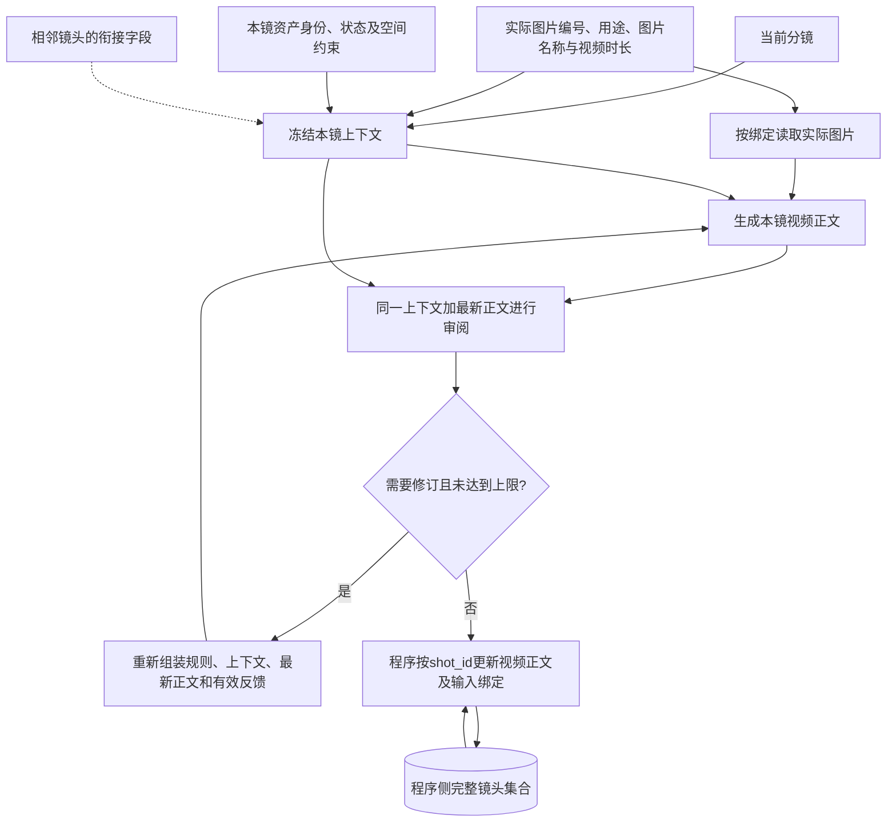

# 单镜头视频提示词上下文

日期：2026-11-16，2026-11-17 改为只依据分镜，不再读取原文。复用现有文字 Agent Loop，不增加检索模型调用。

## 数据流

当前分镜、实际选图和本镜相关资产组成冻结的事实资料；程序补充前后各一个镜头的衔接字段，不读取原文。生成、独立审阅和质量修订共享该事实资料。模型只返回当前镜头结果，完整镜头集合由程序维护。



“重新组装修订请求”指 AI 审阅后的自动质量修订。人工修改分镜、资产、选图或工作流会使旧输入失效，需要重新准备任务。

## 资料与模型协议

- 不提供原文：动作、对白、旁白和声音只依据本镜分镜。本镜发给模型时去掉 `source_refs`，没有原文时这些位置没有意义。旧任务检查点中残留的原文片段也不再发送。
- 补充资料只有相邻镜头的动作、场景、人物与道具引用，不包含邻镜提示词。补充上限为 `min(6000, max_context_chars // 4)` 个序列化字符，依次尝试前镜、后镜；无法容纳的完整项省略并标记在程序侧 `supplement_manifest`。
- 模型看到单镜头、相邻镜头、统一资产列表、实际视频输入及必要配置要求；完整集合、版本控制、图片哈希、节点和来源ID以及提交绑定保留在程序侧。
- 生成、修订和生成格式修复均发送本镜实际选中的图片。在 Chat Completions 的用户消息中，先放文字 Prompt，再按冻结编号和首尾帧顺序，每张以用途标签紧跟一个 `image_url` 图像输入。文件名只辅助定位。图片按哈希校验，原始文件合计上限为 20 MiB。检查点只保存输入绑定及文本，图像编码不写进项目或诊断日志。生成模型需支持多图，审阅仍使用文字和图片名称。
- 初次请求优先采用非空人工编辑正文，否则采用该镜头已有正文，作为一次出现的措辞参考。修订只带最新正文和本轮反馈。
- 生成与格式修复均只返回以下两字段，不接受完整集合、其他镜头或额外字段：

```json
{"shot_id":"当前镜头ID","video_motion_prompt":"按下面格式书写的完整中文视频正文"}
```

视频正文先集中说明图片用途，再给出总体设定、分镜需要的声音和限制，最后按时间书写。

```text
<Picture 1>：用作〔主体或场景〕的〔具体用途〕，保留〔本镜需要的外观或布局要素〕。
<Picture 2>：……
首帧图片：严格约束〔空间布局、物体位置、比例、光线关系〕。
尾帧图片：严格约束……

N秒，〔视角〕，〔质感或风格〕，〔镜头运动和构图变化〕。
声音：〔分镜规定的声音，必要时标注发生的时段〕。
限制：〔本镜必要的画面约束〕。

起–止秒｜〔小标题〕
〔镜头运动、主体动作和画面变化〕
……最后一段写最终停留的画面。
```

- 每张实际选中的图片在开头单列用途。参考图用 `<Picture N>`，首尾帧用角色名称。
- 按动作自然分段，从 0 秒连续覆盖实际时长。图片提供主体外观、位置、姿态和道具状态。首尾帧约束对应端点，分镜规定中间动作，文字描述两端之间可见的变化。图片编号集中在开头。
- 全文可一次复制，正文不用 Markdown 标题、列表符号或代码块。
- 自动审阅核对图片用途与实际选图是否一致、动作段是否重复图片引用、时段是否覆盖实际时长。旧稿仅作为措辞参考，修订按当前格式书写。

审阅仅接收审阅标准、任务要求、同一本镜上下文及最新正文。沿用 `issues` 结构，`target_path` 限定为 `video_motion_prompt`，程序将其转换到完整集合的对应镜头路径。本次不提供原文，审阅 quote=null、source_refs=[]，引用原文按引用错误处理。

审阅请求增加“输出结构约束”分块，包含公共审阅Schema的视频派生规则与一份合法结构示例，
不重复本镜资料或完整镜头集合。Schema、示例和格式反馈均计入冻结的输入预算。
先解析JSON并完成结构和原文业务检查，再添加内部字段及转换镜头路径；报告错误分类为
syntax、schema、reference，携带具体位置或字段路径，不预设错误原因，不自动改写正文。

## 合并、预算和恢复

局部结果在程序侧合入未采用的完整候选，以复用原有校验及检查点；最终事务才替换当前版本。仅更新目标镜头的 `video_motion_prompt` 和代码维护的 `video_prompt_binding`，其余字段、镜头和引用保持原样。每次请求及提交前验证输入仍有效。

默认输入预算仍为48,000字符；预算随新任务冻结，恢复不受新服务实例默认值影响。生成、审阅、修订和格式修复均在发送前检查完整请求。运行调用记录保存总字符数、分块大小和省略项数。字符预算不是模型 token 上限，接口原始错误继续保留。

超预算停止发送，保留原稿、检查点、已有候选和完整反馈；原资料与冻结预算不变时，点击继续仍会在本地阻断，不产生额外模型调用，应缩小资料后准备新任务。审阅网络中断可直接恢复审阅，不重复生成。

质量修订默认最多一次；达到上限仍有提醒则保存最新合法候选，标记 `review_status="issues"`。每稿生成回复和每轮审阅回复各允许一次格式反馈修复，分别使用生成API和校验API；错误、原始回复及本镜资料一并反馈，修复后再次解析。审阅修复使用独立检查点，不占质量修订次数，中断恢复不重置额度。修复仍失败则停止，原稿不替换，不以审阅通过或质量提醒状态提交。所有修复请求仍检查输入预算，网络重试沿用既有策略。

视频提示词只有当前单镜头协议，不保留专用协议版本标记、旧版生成／审阅／回退或旧任务迁移代码。入口直接校验本镜资料、选中镜头和输入预算；不完整任务不能发送或继续。恢复只读取当前项目清单中的任务，不扫描、导入或清理独立任务文件；项目必须具备当前运行存储字段，不自动补齐旧格式。业务内容继续使用完整 `prompt_bundle`，独立的镜头画面提示词由分镜的取景范围、运镜、动作及资产设定编排。

## 验收

`tests/short_video/test_video_prompt.py` 覆盖：每张图片只带名称且不发送哈希；无关镜头从2个增加到35个时三阶段请求长度不变；不读取原文、相邻镜头超预算整项省略；生成、审阅、修订及格式修复预算；最新稿替换旧稿；局部合并和非首镜头；输入变化阻断；冻结预算恢复；缺少当前资料或预算的任务发送前拒绝；不发送完整集合；请求与审阅不带原文。`tests/short_video/test_video_runtime.py` 验证当前任务存储必需字段，以及恢复不扫描独立任务文件。测试使用临时项目及模拟模型，不调用付费模型、图片或视频生成服务。
